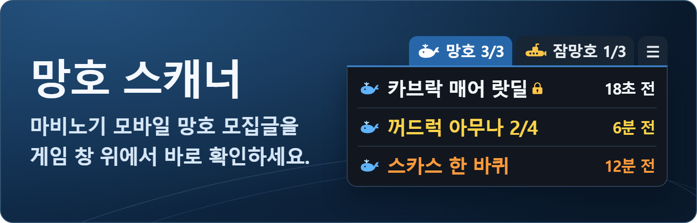
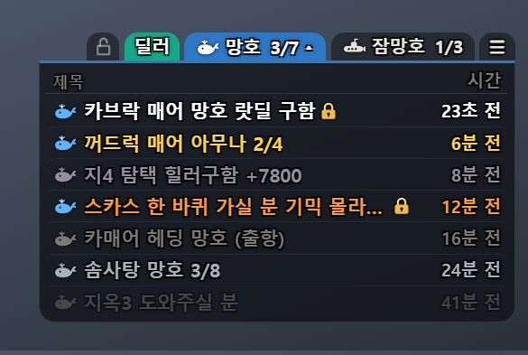

<p align="center"></p>

마비노기 모바일 게임 창 위에 **디시인사이드 에반(마비노기 모바일) 갤러리 🐳 망호 말머리**의 최근 글을 띄우는 오버레이입니다.

- 망호 · 잠망호 탭, 각각 모집 중일 만한 글 최대 10개
- 암호가 걸린 글은 🔒 — 마우스를 올리면 암호

## 실행

1. 받은 zip을 아무 폴더에 풉니다.
2. `망호 스캐너` 폴더의 **`망호 스캐너.exe`**를 실행합니다.
   - Windows "PC 보호" 창이 뜨면 **추가 정보 → 실행** (서명되지 않은 프로그램).
   - 백신이 잡으면 받은 곳이 [GitHub 릴리스](https://github.com/mobingi-widgets/mangho-scanner/releases)인지 확인하세요.
3. 처음 실행하면 **이용 안내**가 뜹니다. 읽는 정보, PC에 남는 정보, 접속처를 확인하고 **동의하고 시작**을 누릅니다. ☰ → ⓘ 이용 안내 보기로 다시 볼 수 있습니다. [안내 화면](docs/img/notice.png)
4. 끄기: **☰ → 종료** (또는 트레이 아이콘 우클릭 → 종료).

- 게임 창이 없으면 일반 창으로 뜨고, 게임이 켜지면 게임 창 위로 옮겨 붙습니다.
- 트레이 아이콘: 회색 = 숨김 · 빨간 점 = 문제.
- 소스로 실행(개발): [Node.js](https://nodejs.org) LTS 설치 후 `망호 스캐너.bat`.

## 화면


<sub>그림의 글·닉네임은 설명용으로 만든 예시입니다.</sub>

| | |
|---|---|
| ① | 탭. `3/7` = 모집 중 / 표시. 열린 탭을 다시 누르면 접기 |
| ② | 내 직군 |
| ③ | ☰ — 누르면 메뉴, 끌면 위치 옮기기. ⚠ = 문제, 초록 점 = 새 버전 |
| ④ | 모집 중인 글 |
| ⑤ | 직군이 다른 글 (흐리게) |
| ⑥ | 출항 (흐리게) |
| ⑦ | 높이 선 |
| ⑧ | 🔒 암호 |

  

- 글 색은 올라온 뒤 지난 시간입니다: 흰색 → 노랑(5분) → 주황(10분).
- 20분이 지나면 출항처럼 흐리게 표시합니다.
- 표시할 글이 없으면 고래나 잠수함이 물에 잠긴 그림과 함께 “망호 없음..” 또는 “잠망호 없음..”이 뜹니다.
- 줄에 마우스를 올리면 자세한 정보, 누르면 글이 열립니다.
- 클릭은 목록 밖이면 게임으로 그대로 갑니다. 키보드 입력은 가져가지 않습니다.

## ☰ 메뉴

 

- 메뉴 밖을 한 번 누르면 메뉴만 닫힙니다. 줄에 마우스를 올리면 맨 아래에 설명.
- **맨 위 줄** — 마지막 스캔 뒤 지난 시간. 초록 점 = 정상 · 빨간 점 = 문제 · 회색 = 쉬는 중.
- **지금 스캔** — 진행과 결과(새 글 수)를 알림 한 줄로 보여 줍니다.
- **작성자** — 닉 앞 그림은 작성자 유형(고닉 · 반고닉 · 신규 · 매니저 · 부매니저, 마우스를 올리면 이름). `겹칠 때`: 같은 닉이 둘 이상이면 식별 코드를 붙입니다.
- **알림** — 끔, 또는 뜨는 자리(위 · 가운데 · 아래). 업데이트 결과와 새로 생긴 문제를 게임 창 위에 잠깐 띄웁니다. 망호 글은 알리지 않습니다.
  - 게임 창이 내려가 있는 동안 온 알림은 돌아오면 한 줄로 모아 보여 줍니다.
  - 주간 납품 위젯의 알림과 따로 돌아서, 같이 뜨면 겹칠 수 있습니다.
- **맨 아래 아이콘** — 이용 안내 보기 · 위치 초기화 · 알림 등급(누를 때마다 모두 → 주의 → 행동) · 시험 알림. 오른쪽 끝 종료.

  

## 크기 · 위치

 

- 오버레이는 정해 둔 **영역** 안에 그려집니다. 내용이 늘거나 줄어도 영역은 그대로이고, 넘치면 스크롤. 빈 곳은 클릭이 게임으로 갑니다.
- 내용에 마우스를 올리면 영역 테두리(흐린 점선)와 높이·너비 막대가 나타납니다.
- **높이** — 영역 끝 선을 끕니다. 두 번 클릭하면 게임 창 끝까지.
- **너비** — 영역 옆 세로 선을 끕니다. 두 번 클릭하면 기본 너비.
- **글자** — ☰ → 글자 (작게 · 중간 · 크게).
- **위치** — ☰를 끌어 옮깁니다.
  - 게임 창 가장자리에 붙고, 다른 오버레이(주간 납품 위젯 등)는 피합니다.
  - 위 가장자리에 붙이면 아래로, 아래 가장자리에 붙이면 위로 펼칩니다(탭이 아래, 목록이 위). 붙이지 않으면 가까운 쪽.
  - 게임 창을 옮기거나 크기를 바꿔도 따라갑니다.
  - ☰ → 위치 초기화로 기본 자리.

## 내 직군

- 헤더 맨 앞 칩을 눌러 고릅니다.
- 설정한 직군과 일치하지 않는 게시글을 흐리게 표시합니다.

## 암호

- 암호가 걸린 글은 제목 뒤에 🔒가 붙습니다. 제목이 잘려도 자물쇠는 남습니다.
- 줄에 마우스를 올리면 툴팁 맨 위에 암호가 나옵니다.
- 작성자가 댓글로 암호를 바꾸면 그쪽을 보여 줍니다.
- 그림 속 암호는 읽지 못합니다.

## 갤러리에 보내는 요청

- 1분에 한 번 망호 탭 목록 1페이지를 읽습니다.
- 보는 범위 안의 글만 보이고, 그 글만 더 읽습니다: 망호는 1시간, 잠망호는 제목의 끝 시각까지(없으면 8시간).
- 본문은 처음 표시할 때 읽고, 제목이 바뀌거나 읽기에 실패하면 다시 요청할 수 있습니다.
- 댓글은 댓글이 달린 글을 처음 확인할 때와 댓글 수가 바뀔 때 읽습니다. 읽기에 실패하면 다시 시도할 수 있습니다.
- 숨긴 동안은 쉽니다.
- 로그인하지 않으며 글·댓글을 쓰지 않습니다.

## 게임과의 관계

- 게임 클라이언트·게임 통신에는 손대지 않습니다.
- `gamewin.ps1`이 Windows에 "마비노기 모바일" 창의 위치와 크기만 물어봅니다.

## 업데이트


 

- 켤 때와 6시간마다 [GitHub 릴리스](https://github.com/mobingi-widgets/mangho-scanner/releases)를 확인합니다.
- ☰ → 업데이트 줄: ↻ 지금 확인 · `자동` 끄기. 새 버전이면 버전 옆 초록 점, 누르면 업데이트 창.
- 새 버전이 있으면 ☰ 아래에 **새로운 업데이트가 있습니다!** 말풍선이 뜹니다. 누르면 업데이트 창.
- 스스로 설치하거나 재시작하지 않습니다.
- 원래 주소에 릴리스가 없으면 서명된 안내판(`mobingi-widgets/feeds`)에서 새 주소를 찾습니다.
- 업데이트를 누르면 받기 → 서명 확인 → 설치 → 다시 시작합니다.
- 이용 안내가 바뀐 버전이면 먼저 다시 묻습니다. 동의하지 않으면 지금 버전을 그대로 씁니다.
- 서명을 확인한 파일만 설치합니다(프로그램에 든 공개키 · minisign).
- 새 버전이 1분 안에 정상으로 뜨지 않으면 이전 버전으로 되돌립니다(`resources\.update\previous`).
- 교체 스크립트가 시작된 것을 확인한 뒤에만 스캐너가 꺼집니다. 시작되지 않으면 지금 버전 그대로 실패를 알립니다.
- Electron이 바뀌는 버전은 릴리스 페이지에서 새로 받습니다.
- 기록: `%APPDATA%\mangho-scanner\update.log`.

### 1.5.1 이하에서 1.6.0으로 — 한 번만 손으로

- 1.5.1까지는 앱 안에서 **업데이트**를 누르면 스캐너가 꺼진 뒤 다시 켜지지 않습니다. 파일은 그대로라 다시 실행하면 원래 버전입니다.
- 1.6.0은 한 번 손으로 올립니다. 1.6.0부터는 앱 안에서 업데이트됩니다.

1. ☰ → 종료.
2. [릴리스 v1.6.0](https://github.com/mobingi-widgets/mangho-scanner/releases/tag/v1.6.0)에서 `mangho-scanner-1.6.0-app.zip`을 받습니다.
3. `망호 스캐너\resources\app` 폴더를 `망호 스캐너\resources\.update\previous`로 옮깁니다(이미 있으면 그 폴더를 먼저 지움).
4. 새 `resources\app` 폴더를 만들어 받은 zip을 그 안에 풉니다. (`mangho-scanner-1.6.0-full.zip`으로 폴더째 바꿔도 됩니다.)
5. `망호 스캐너.exe` 실행. 이용 안내가 뜨면 **동의하고 시작**.

## 설정

- 설정은 `%APPDATA%\mangho-scanner\overlay.json`에 저장됩니다.
- 오버레이끼리 자리를 피하려고 `%APPDATA%\mabimo-overlays\`에 자기 자리를 적습니다.
- 다른 갤러리·말머리·키워드를 보려면 `overlay.json`에 `source`를 넣습니다(끄고 고친 뒤 다시 켜기).

```json
{ "source": { "gallery": "enban", "kind": "mgallery", "head": 140, "name": "에반(마비노기 모바일)", "keywords": ["출항", "출발"], "max": 10 } }
```

## 파일

| 파일 | 하는 일 |
|---|---|
| `scanner.js` | 망호 탭 읽기·출항 판정. `node scanner.js`로 한 번 스캔해서 결과만 출력 (Electron 없이) |
| `main.js` | 오버레이 창·배치·☰ 메뉴·1분 스캔 |
| `gamewin.ps1` | 게임 창 위치 추적 (Windows 창 조회만) |
| `dock.js` · `guide.html` · `guide.js` · `guide-preload.js` | ☰ 끌기 위치 옮기기와 그 안내 화면 (주간 납품 위젯과 같은 파일) |
| `renderer.js` `index.html` `style.css` | 목록 화면 |
| `tip.js` `tip.html` | 툴팁 창 |
| `toast-ui.js` · `toast.html` · `toast.js` · `toast-preload.js` | 알림(토스트) 창 (주간 납품 위젯과 같은 파일 — 실행 중에는 서로 모름) |
| `preload.js` | 화면 ↔ 본체 연결 |
| `망호 스캐너.bat` | 실행 (첫 실행 시 Electron 설치) |
| `updater.js` · `apply-update.ps1` | 업데이트 확인·서명 검증·교체·되돌리기 (주간 납품 위젯과 같은 파일) |
| `build_dist.py` · `build_exe.js` | 배포본 만들기 (개발용): exe 빌드(@electron/packager) → zip. `npm install` 후 `python build_dist.py`, 릴리스 파일은 `--release` |

변경 이력은 [CHANGELOG.md](CHANGELOG.md).
