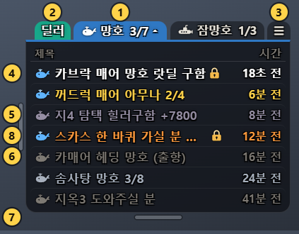
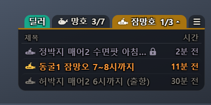
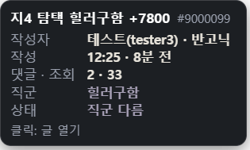
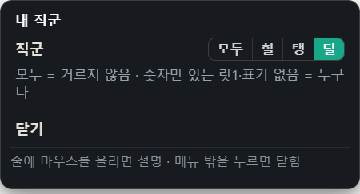
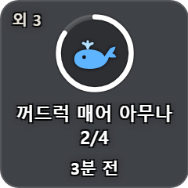
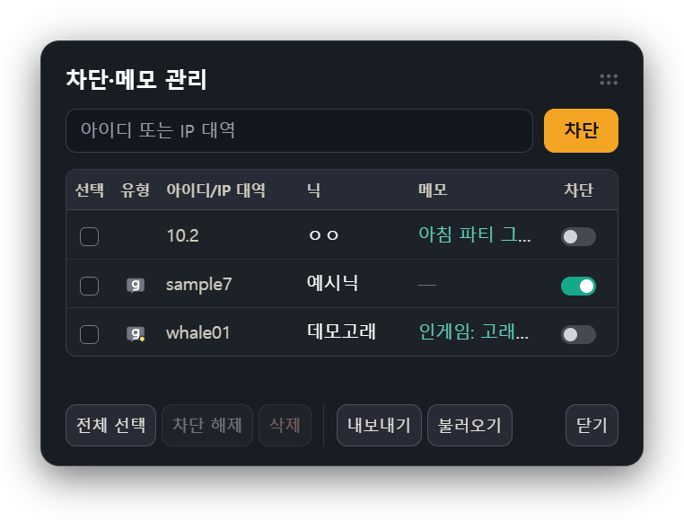
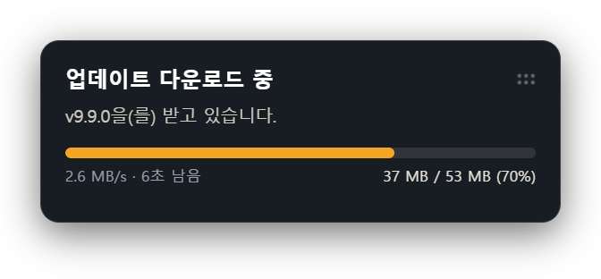

<p align="center"></p>

마비노기 모바일 게임 창 위에 **디시인사이드 에반(마비노기 모바일) 갤러리 🐳 망호 말머리**의 최근 글을 띄우는 오버레이입니다.

- 망호 · 잠망호 탭, 각각 모집 중일 만한 글 최대 10개
- 암호가 걸린 글은 🔒 — 마우스를 올리면 암호, 누르면 복사

## 실행

1. [최신 처음 설치 파일](https://github.com/mobingi-widgets/mangho-scanner/releases/latest/download/mangho-scanner-full.zip)을 받아 아무 폴더에 풉니다([릴리스 페이지](https://github.com/mobingi-widgets/mangho-scanner/releases/latest)).
   - 릴리스의 다른 파일은 앱이 업데이트할 때 씁니다.
2. `망호 스캐너` 폴더의 **`망호 스캐너.exe`**를 실행합니다.
   - Windows "PC 보호" 창이 뜨면 **추가 정보 → 실행** (서명되지 않은 프로그램).
   - 백신이 잡으면 받은 곳이 [GitHub 릴리스](https://github.com/mobingi-widgets/mangho-scanner/releases)인지 확인하세요.
3. 처음 실행하면 **이용 안내**가 뜹니다. 읽는 정보, PC에 남는 정보, 접속처를 확인하고 **동의하고 시작**을 누릅니다. ☰ → ⓘ 이용 안내 보기로 다시 볼 수 있습니다. [안내 화면](docs/img/notice.png)
4. 끄기: **☰ → 종료** (또는 트레이 아이콘 우클릭 → 종료).

- 게임 창이 없을 때는 ☰ → 게임 없을 때 `[숨김 | 창]`(처음엔 숨김).
  - 숨김: 게임을 끄면 3초 뒤 트레이 아이콘으로 숨고, 게임이 켜지면 게임 창 위로 돌아옵니다. 숨은 동안은 스캔하지 않습니다.
  - 창: 일반 창으로 뜨고, 게임이 켜지면 게임 창 위로 옮겨 붙습니다.
  - 게임 없이 직접 실행하면 어느 쪽이든 일반 창으로 뜹니다.
- 트레이 아이콘: 회색 = 숨김(게임이 없어 숨은 것도) · 빨간 점 = 문제. 누르면 보이기 / 숨기기.
- 소스로 실행(개발): [Node.js](https://nodejs.org) LTS 설치 후 `망호 스캐너.bat`.

### 부팅 시 자동 실행

- ☰ 맨 아래 아이콘(모니터 그림) — `네` / `아니오`, 처음엔 아니오. 켜져 있으면 그림이 초록색입니다.
- 켜면 Windows에 로그인할 때 스캐너가 숨은 채 시작하고, 게임이 켜지면 나타납니다(게임 없을 때 = 숨김일 때).
- Windows 설정 → 앱 → 시작 앱(또는 작업 관리자 → 시작 앱)에서도 끌 수 있습니다. 그러면 메뉴에 `Windows 설정에서 꺼짐`으로 나옵니다.
- 폴더를 옮기면 다음 실행 때 새 자리로 다시 등록합니다.
- **폴더를 지우기 전에 끄세요.** 압축을 풀어 쓰는 프로그램이라 제거 프로그램이 없습니다. 남은 항목은 해가 없지만 시작 앱 목록에 남습니다.
- 켜고 끌 때마다 정말 등록됐는지(지워졌는지) 다시 확인합니다. 안 됐으면 ☰ 아래 말풍선에 `시작 프로그램에 등록하지 못했습니다`(또는 `지우지 못했습니다`)가 뜨고, 설정은 `아니오`로 남습니다.
  - 보통 보안 프로그램이 시작 프로그램 등록을 막았거나, 회사·학교 PC의 정책이 막은 경우입니다. 보안 프로그램에서 허용한 뒤 다시 켜세요. 정책이 막은 PC에서는 쓸 수 없습니다.
  - 다른 폴더에 다시 설치해도 달라지지 않습니다.
- 다른 Windows 계정과 같이 쓰는 PC라면 내 계정 폴더(예: `%LOCALAPPDATA%`)에 설치하세요. 다른 계정도 고칠 수 있는 폴더(보조 드라이브의 기본 권한 등)에 두면, 그 계정이 바꾼 파일이 로그인 때 자동으로 실행될 수 있습니다.

## 화면



<sub>그림의 글·닉네임은 설명용으로 만든 예시입니다.</sub>

| | |
|---|---|
| ① | 탭. `3/7` = 모집 중 / 표시. 열린 탭을 다시 누르면 접기 |
| ② | 내 직군 |
| ③ | ☰ — 누르면 메뉴, 끌면 위치 옮기기. ⚠ = 문제, 초록 점 = 새 버전 |
| ④ | 모집 중인 글 |
| ⑤ | 직군이 다른 글 (흐리게) |
| ⑥ | 출항 (흐리게) |
| ⑦ | 높이 선 |
| ⑧ | 🔒 암호 |

  

- 글 색은 올라온 뒤 지난 시간입니다: 흰색 → 노랑(5분) → 주황(10분).
- 20분이 지나면 출항처럼 흐리게 표시합니다.
- 표시할 글이 없으면 고래나 잠수함이 물에 잠긴 그림과 함께 “망호 없음..” 또는 “잠망호 없음..”이 뜹니다.
- 줄에 마우스를 올리면 자세한 정보, 누르면 글이 열립니다.
- 줄을 우클릭하면 메뉴: 닉네임 복사하기(메모가 있으면 메모 먼저) · 암호 복사하기 · 차단 · 메모 쓰기 · 글 열기.
- 목록 머리를 누르면 그 칸이 바뀝니다. 한 번 더 누르면 원래대로.
  - `작성자` — 코드만(`데모고래` → `whale01`, `ㅇㅇ(10.2)` → `10.2`). ☰ → 작성자 `코드`와 같습니다.
  - `시간` — 짧게(`47분 전` → `47m`). 제목 칸이 그만큼 넓어집니다.
- 클릭은 목록 밖이면 게임으로 그대로 갑니다. 키보드 입력은 가져가지 않습니다.

## ☰ 메뉴

 

- 메뉴 밖을 한 번 누르면 메뉴만 닫힙니다. 줄에 마우스를 올리면 맨 아래에 설명.
- **맨 위 줄** — 마지막 스캔 뒤 지난 시간. 초록 점 = 정상 · 빨간 점 = 문제 · 회색 = 쉬는 중.
- **지금 스캔** — 진행과 결과(새 글 수)를 알림 한 줄로 보여 줍니다. 스캔은 10초에 한 번까지라, 그 안에 누르면 몇 초 뒤에 합니다.
- **게임 없을 때** — [숨김 | 창]. 게임 창을 찾지 못할 때 트레이로 숨을지, 일반 창으로 보일지. 게임이 켜지거나 꺼지는 순간에만 적용합니다.
- **잠망호 표시** — [표시 | 따로 표시 | 숨김]. 표시는 망호 탭에 함께, 숨김은 잠망호 글을 읽지도 세지도 않습니다.
- **작성자** — [끔 | 닉 | 닉(코드) | 코드]. `닉(코드)`: 반고닉은 아이디, 유동은 IP 앞자리, 고닉은 닉만. `코드`: 코드만(고닉도 아이디). 메모를 쓴 작성자는 어느 쪽이든 메모.
  - 닉 앞 그림은 작성자 유형(고닉 · 반고닉 · 신규 · 매니저 · 부매니저, 마우스를 올리면 이름).
  - 작성자 칸에 마우스를 올리면 잘린 닉까지 전체(닉(코드) · 유형), 누르면 닉네임을 복사합니다.
- **알림** — 끔, 또는 뜨는 자리(위 · 가운데 · 아래). 업데이트 결과와 새로 생긴 문제를 게임 창 위에 잠깐 띄웁니다. 망호 글은 아래 새 망호 알림을 켰을 때만 알립니다. 누르면 닫힙니다(뜬 직후 0.2초는 클릭이 게임으로).
- **새 망호 알림** — [끔 | 켬], 처음엔 끔. 자동 스캔이 새로 찾은 모집 중인 글을 알림 두 줄로 띄웁니다(종류 그림과 `새 망호` · 제목).
- **새 망호 소리** — `[−] 음소거 [+]` 음량(음소거 · 10~100%), 처음엔 음소거. 새 망호 알림이 뜰 때 짧은 소리(파도·갈매기)를 냅니다. 바꾸면 그 음량으로 한 번 들려줍니다. 1분에 한 번까지이고, 게임 창이 안 보이는 동안 모인 알림에는 내지 않습니다.
  - 망호와 잠망호는 따로, 여러 개면 `새 망호 3개` · `제목 외 2`로 묶습니다.
  - 출항 · 20분 지남 · 직군 다름 · 차단한 작성자의 글과, 숨긴 잠망호는 알리지 않습니다.
  - 알림 등급과 상관없이 뜹니다. 알림을 끄면 뜨지 않습니다.
  - 게임 창이 내려가 있는 동안 온 알림은 돌아오면 한 줄로 모아 보여 줍니다.
  - 주간 납품 위젯의 알림과 따로 돌아서, 같이 뜨면 겹칠 수 있습니다.
- **차단·메모 관리** — 차단한 작성자와 메모 목록. 아이디·IP 대역으로 직접 차단, 여러 개 해제·삭제, 내보내기·불러오기(다른 PC로 옮길 때).
- **맨 아래 아이콘** — 이용 안내 보기 · 위치 초기화 · 부팅 시 자동 실행 · 알림 등급(누를 때마다 모두 → 주의 → 행동) · 시험 알림. 오른쪽 끝 종료.

  

## 크기 · 위치

 

- 오버레이는 정해 둔 **영역** 안에 그려집니다. 내용이 늘거나 줄어도 영역은 그대로이고, 넘치면 스크롤. 빈 곳은 클릭이 게임으로 갑니다.
- 내용에 마우스를 올리면 영역 테두리(흐린 점선)와 높이·너비 막대가 나타납니다.
- **높이** — 영역 끝 선을 끕니다. 두 번 클릭하면 게임 창 끝까지.
- **너비** — 영역 옆 세로 선을 끕니다. 게임 창 가장자리에 붙지 않은 영역은 양쪽 모두. 두 번 클릭하면 기본 너비.
- **배율** — ☰ → 배율 `[−] 100% [+]` (70~150%). 목록·메뉴·말풍선 전체 크기입니다.
- **글자** — ☰ → 글자 `[−] 100% [+]` (80~150%). 목록·툴팁의 글자만 커지고, 그만큼 줄이 높아집니다.
- **자동 잠금** — 머리줄 맨 앞 자물쇠 단추. 켜 두면 목록 밖으로 나가고 3초 뒤 흐려지고 마우스가 통과합니다. 목록 위에서 마우스를 흔들면 풀립니다(트레이 메뉴 `잠금 해제`도).
  - 잠긴 목록 위에 마우스를 올려 두면(0.15초) 거의 투명해져 아래 게임 화면이 보이고, 클릭도 게임으로 갑니다. ☰ 자리의 작은 🔒만 남고, 마우스가 떠나면 0.5초 뒤 다시 흐려집니다. 스쳐 지나가면 그대로입니다.
  - 흔들기 시작하면 큰 🔒가 나옵니다. 끝까지 흔들면 풀립니다.
- **잠금 때** — ☰ → 잠금 때 `[그대로 | 작게 | 매우 작게]`. 잠긴 동안의 크기입니다.
  - 작게: 가장 작은 배율·글자로 줄어듭니다.
  - 매우 작게: 도킹한 모서리의 작은 칸(배율 100에서 120 × 120)에 가장 새 모집 중 글 하나만 — 종류 아이콘과 20분 동안 닳는 고리, 제목 두 줄, 시간, 고리 오른쪽 아래 `N+`(모집 중인 다른 글 수). 바탕은 잠금 안내처럼 가장자리로 갈수록 옅어지는 그림자뿐이고 테두리가 없습니다. 망호·잠망호를 함께 봅니다(잠망호 숨김이면 빼고). 모집 중인 글이 없으면 빈 그림. 칸 위에서 흔들면 풀립니다.<br>
- **위치** — ☰를 끌어 옮깁니다.
  - 게임 창 가장자리에 붙고, 다른 오버레이(주간 납품 위젯 등)는 피합니다.
  - 위 가장자리에 붙이면 아래로, 아래 가장자리에 붙이면 위로 펼칩니다(탭이 아래, 목록이 위). 붙이지 않으면 가까운 쪽.
  - 게임 창을 옮기거나 크기를 바꿔도 따라갑니다.
  - ☰ → 위치 초기화로 기본 자리.

## 내 직군

- 헤더 맨 앞 칩을 눌러 고릅니다.
- 설정한 직군과 일치하지 않는 게시글을 흐리게 표시합니다.

## 출항

- 제목이나 작성자 댓글(글자·디시콘 이름)로 판정합니다. 툴팁 `상태`에 걸린 말이 나옵니다(`마감 (제목)` · `침몰 (작성자 댓글 01:39)`).
- **어디에 있어도** — 출항 · 출발 · 마감 · 종료.
  - 빼는 것: 시각 바로 뒤의 마감·종료(`09:00 마감`, `10시 종료` — 끝나는 시각), `출발못`·`출항못`, 제목의 `재출발`·`재출항`(나중 계획).
- **따로 있을 때만** — 완 · 완료 · 풀 · 풀방 · 펑 · 침몰 · 끝 · 취소 · ㅊㅎ.
  - 괄호 안 끝(`(완)` `-풀방-` `[사람안구해서펑..]`), 맨 끝(`스카스 침몰`, 댓글 `완`), 맨 앞 괄호(`완)물길 망호`).
  - 문장 속 말은 세지 않습니다: `1번째 완료 다시 ㄱㄱ`, `5분후 침몰 예정`, `풀강`.
- **디시콘** — 이름에 출항 · 출발 · 침몰 · 펑. 그리고 모비에반콘 24(출항) · 45(침몰) — 번호가 아니라 그림으로 알아봅니다(다른 묶음의 같은 번호는 세지 않음).

## 암호

- 암호가 걸린 글은 제목 뒤에 🔒가 붙습니다. 제목이 잘려도 자물쇠는 남습니다.
- 줄에 마우스를 올리면 툴팁 맨 위에 암호가 나옵니다.
- 🔒에 마우스를 올리면 암호만 작은 말풍선으로, 누르면 복사합니다. 귓속말로 받는 암호는 복사할 것이 없습니다.
- 작성자가 댓글로 암호를 바꾸면 그쪽을 보여 줍니다.
- 그림 속 암호는 읽지 못합니다.
- 퍼 온 글(펌)은 같은 작성자의 원글이 목록에 함께 있으면 그 암호를 보여 줍니다. 툴팁에는 `암호 (원글)`로 나옵니다.
- 같은 작성자가 같은 원글을 다시 퍼 오면 원글을 올린 지 3시간까지 그 암호를 붙입니다(원글 20개까지, 메모리에만 두고 끄면 사라집니다).
- **퍼 온 글 표시**(제목 뒤 흐린 화살표) — 스캐너는 원글을 따로 읽지 않습니다. 이 표시가 있으면 글을 열어 확인하세요.
- 펌이나 이 갤러리 글 링크가 있는 글은 우클릭 → `원글 열기`로 원글을 엽니다. 원글의 댓글(바뀐 암호 등)은 거기에만 있습니다.

## 차단 · 메모



- 줄을 우클릭해 작성자를 **차단**하거나 **메모**를 남깁니다. 고닉·반고닉은 아이디, 유동은 IP 앞 두 자리 대역 단위입니다.
- 차단한 작성자의 글은 출항처럼, 더 흐리게 보이고 모집 중 숫자와 '새 글'에서 빠집니다.
- 유동 대역을 차단하면 같은 통신사를 쓰는 다른 사람의 글도 함께 가려질 수 있어 먼저 묻습니다.
- 메모를 쓴 작성자는 작성자 칸에 닉 대신 메모가 보이고, 누르면 메모를 복사합니다. 툴팁에는 닉과 메모가 함께 나옵니다.
- 목록은 `%APPDATA%\mangho-scanner\authors.json`에 남습니다. ☰ → 차단·메모 관리에서 고치거나 내보냅니다.

## 갤러리에 보내는 요청

- 1분에 한 번 망호 탭 목록 1페이지를 읽습니다. 지금 스캔 등으로 더 자주 하더라도 스캔 사이는 10초 이상입니다.
- 보는 범위 안의 글만 보이고, 그 글만 더 읽습니다: 망호는 1시간, 잠망호는 제목의 끝 시각까지(없으면 8시간).
- 본문은 처음 표시할 때 읽고, 제목이 바뀌거나 읽기에 실패하면 다시 요청할 수 있습니다.
- 댓글은 댓글이 달린 글을 처음 확인할 때와 댓글 수가 바뀔 때 읽습니다. 읽기에 실패하면 다시 시도할 수 있습니다.
- 숨긴 동안(게임이 없어 숨은 동안 포함)은 쉽니다. 게임이 다시 켜지면 바로 한 번 읽고, 그사이 올라온 글은 새 망호로 알리지 않습니다.
- 로그인하지 않으며 글·댓글을 쓰지 않습니다.

## 게임과의 관계

- 게임 클라이언트·게임 통신에는 손대지 않습니다.
- `gamewin.ps1`이 Windows에 "마비노기 모바일" 창의 위치와 크기만 물어봅니다.

## 업데이트


 

- 켤 때와 6시간마다 [GitHub 릴리스](https://github.com/mobingi-widgets/mangho-scanner/releases)를 확인합니다.
- ☰ → 업데이트 줄: ↻ 지금 확인 · `자동` 끄기. 새 버전이면 버전 옆 초록 점, 누르면 업데이트 창.
- 새 버전이 있으면 ☰ 아래에 **새로운 업데이트가 있습니다!** 말풍선이 뜹니다. 누르면 업데이트 창.
- 스스로 설치하거나 재시작하지 않습니다.
- 원래 주소에 릴리스가 없으면 서명된 안내판(`mobingi-widgets/feeds`)에서 새 주소를 찾습니다.
- 업데이트를 누르면 받기 → 서명 확인 → 설치 → 다시 시작합니다.
- 이용 안내가 바뀐 버전이면 먼저 다시 묻습니다. 동의하지 않으면 지금 버전을 그대로 씁니다.
- 서명을 확인한 파일만 설치합니다(프로그램에 든 공개키 · minisign).
- 새 버전이 1분 안에 정상으로 뜨지 않으면 이전 버전으로 되돌립니다(`resources\.update\previous`).
- 교체 스크립트가 시작된 것을 확인한 뒤에만 스캐너가 꺼집니다. 시작되지 않으면 지금 버전 그대로 실패를 알립니다.
- Electron이 바뀌는 버전은 릴리스 페이지에서 새로 받습니다.
- 기록: `%APPDATA%\mangho-scanner\update.log`.
- 앱 안 업데이트가 안 되는 옛 판(1.5.1 이하)은 ☰ → 종료 후 `full.zip`으로 다시 설치합니다. 설정은 그대로 남습니다.

## 설정

- 설정은 `%APPDATA%\mangho-scanner\overlay.json`에 저장됩니다.
- 오버레이끼리 자리를 피하려고 `%APPDATA%\mabimo-overlays\`에 자기 자리를 적습니다.
- 다른 갤러리·말머리·키워드를 보려면 `overlay.json`에 `source`를 넣습니다(끄고 고친 뒤 다시 켜기).

```json
{ "source": { "gallery": "enban", "kind": "mgallery", "head": 140, "name": "에반(마비노기 모바일)", "keywords": [], "max": 10 } }
```

- `keywords` — [출항](#출항) 규칙에 더해, 어디에 있어도 출항으로 볼 말(기본 없음).

## 파일

| 파일 | 하는 일 |
|---|---|
| `scanner.js` | 망호 탭 읽기·출항 판정. `node scanner.js`로 한 번 스캔해서 결과만 출력 (Electron 없이) |
| `main.js` | 오버레이 창·배치·☰ 메뉴·1분 스캔 |
| `gamewin.ps1` | 게임 창 위치 추적 (Windows 창 조회만) |
| `dock.js` · `guide.html` · `guide.js` · `guide-preload.js` | ☰ 끌기 위치 옮기기와 그 안내 화면 (주간 납품 위젯과 같은 파일) |
| `renderer.js` `index.html` `style.css` | 목록 화면 |
| `tip.js` `tip.html` | 툴팁 창 |
| `toast-ui.js` · `toast.html` · `toast.js` · `toast-preload.js` | 알림(토스트) 창 (주간 납품 위젯과 같은 파일 — 실행 중에는 서로 모름) |
| `preload.js` | 화면 ↔ 본체 연결 |
| `sounds/` | 새 망호 소리 — 파도 transitking(Freesound 11505) · 갈매기 Lydmakeren(Freesound 510917), 둘 다 CC0 (`sounds/LICENSE.txt`) |
| `망호 스캐너.bat` | 실행 (첫 실행 시 Electron 설치) |
| `updater.js` · `apply-update.ps1` | 업데이트 확인·서명 검증·교체·되돌리기 (주간 납품 위젯과 같은 파일) |
| `nogame.js` · `autostart.js` | 게임 창이 없을 때 · 부팅 시 자동 실행 (주간 납품 위젯과 같은 파일) |
| `scripts/build_dist.py` · `scripts/build_exe.js` | 배포본 만들기 (개발용): exe 빌드(@electron/packager) → zip. `npm install` 후 `python scripts/build_dist.py`, 릴리스 파일은 `--release`(먼저 `npm test`, 실패하면 만들지 않음) |
| `test/` | 시험 (개발용, 배포본에 들어가지 않음): `npm test` — 단위 시험(node)과 화면 밖 페이지 시험(Electron, 화면에 창을 띄우지 않음) |

변경 이력은 [CHANGELOG.md](CHANGELOG.md).
