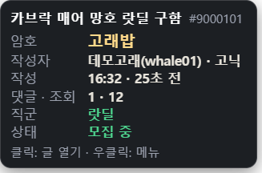
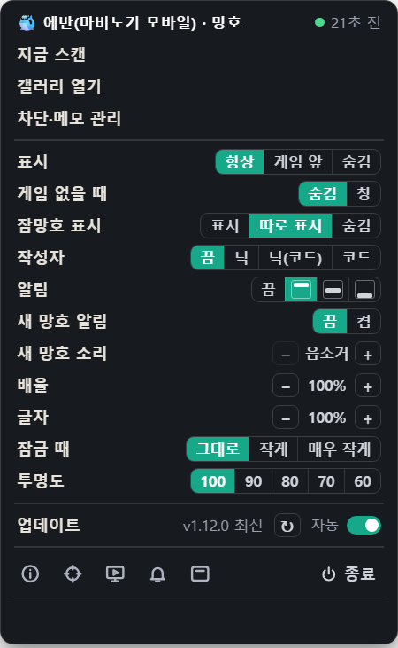
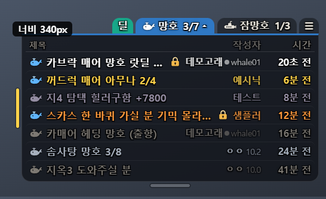
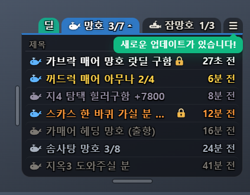
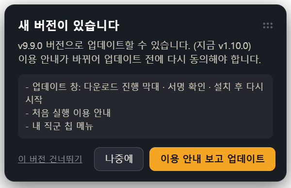

<p align="center"></p>

마비노기 모바일 게임 창 위에 **디시인사이드 에반(마비노기 모바일) 갤러리의 🐳 망호 말머리** 최근 글을 띄우는 오버레이입니다.
게임을 하면서 브라우저를 따로 보지 않아도 지금 모집 중인 망호를 바로 볼 수 있습니다.
**일반 망호**(레이드·어비스 공략)와 **잠수함 망호**(자동 사냥을 오래 돌리는 파티)를 탭으로 나눠, 아직 모집 중일 만한 글만
(일반 1시간 안 · 잠수함은 제목의 끝 시각까지) 각각 최대 10개 보여 줍니다. 암호가 걸린 망호는 🔒, 마우스를 올리면 암호가 보입니다.

## 실행

1. 받은 zip을 아무 폴더에 풉니다.
2. `망호 스캐너` 폴더의 **`망호 스캐너.exe`**를 실행합니다. 따로 설치할 것은 없습니다.
   - 서명되지 않은 프로그램이라 처음에 Windows가 "PC 보호" 창을 띄울 수 있습니다 → **추가 정보 → 실행**.
   - 같은 이유로 백신(Windows Defender 등)이 잘못 잡는 일이 있습니다. 받은 곳이
     [GitHub 릴리스](https://github.com/mobingi-widgets/mangho-scanner/releases)인지 확인하세요.
3. 처음 실행하면 **이용 안내**(하는 일 · 읽는 것 · 남기는 것 · 접속하는 곳)가 뜹니다(<a href="docs/img/notice.png">그림</a>). **동의하고 시작**을 눌러야 스캐너가 시작하고,
   동의하지 않으면 아무것도 하지 않고 끝납니다. ☰ → 이용 안내 보기로 다시 볼 수 있습니다.
4. 끄기: 오른쪽 위 **☰ → 종료** (또는 트레이 아이콘 우클릭 → 종료).
5. 새 버전은 스캐너가 알려 줍니다 (아래 "업데이트").

소스로 실행할 때(개발): [Node.js](https://nodejs.org) LTS를 설치하고 `망호 스캐너.bat` — 첫 실행 때 Electron을 내려받느라 1~2분 걸립니다.

게임 창이 없으면 일반 창으로 뜨고, 게임이 켜지면 게임 창 위(기본: 오른쪽, 퀘스트 목록 아래)로 옮겨 붙습니다.

## 화면 읽는 법


<sub>그림의 글·닉네임은 설명용으로 만든 예시입니다.</sub>

| | |
|---|---|
| ① | 탭 — 일반 망호 / 잠수함 망호. `3/7` = 모집 중 / 표시. 다른 탭을 누르면 전환, 열린 탭을 다시 누르면 접기 |
| ② | 내 직군 (`모`·`힐`·`탱`·`딜`) — 누르면 고르는 메뉴 |
| ③ | ☰ — 누르면 메뉴, 끌면 위치 옮기기. 문제가 있으면 빨간 ⚠, 새 버전이 있으면 초록 점 |
| ④ | 모집 중인 글. 글 색 = 올라온 뒤 지난 시간 (아래 표) |
| ⑤ | 보랏빛 회색 = 찾는 직군이 내 직군과 다름 (모집 중 개수에서 뺌) |
| ⑥ | 회색 = 출항 |
| ⑦ | 높이 선 — 끌어서 최대 높이, 두 번 클릭하면 제한 없음 |
| ⑧ | 🔒 = 암호가 걸린 망호. 줄에 마우스를 올리면 암호. 제목이 길어 `…`로 잘려도 자물쇠는 남습니다 |

  

- 탭 = 일반 망호(고래) / 잠수함 망호(잠수함). 숫자는 그 탭의 모집 중 / 표시 개수.
  다른 탭을 누르면 그 탭으로, 열린 탭을 다시 누르면 목록 접기/펼치기.
- 제목 앞 아이콘도 같은 구분. 모집 중으로 세지 않는 글(출항 · 20분 지남 · 직군 다름)은 아이콘도 제목과 같은 색이 됩니다.
- 맨 앞 `모` 칩 = 내 직군 (아래 "내 직군").

| 글 색 | 뜻 |
|---|---|
| 흰색 | 모집 중, 올라온 지 5분 안 |
| 노랑 | 모집 중, 5분 지남 |
| 주황 | 모집 중, 10분 지남 |
| 보랏빛 회색 | 내 직군을 골랐을 때, `랏` 뒤 직군이 내 직군과 다름 — 모집 중 개수에서 뺌 (눈에 띄지 않게 회색에 가깝게) |
| 옅은 회청색 | 출항 표시 없이 20분 지남 — 사실상 출항으로 보고 모집 중 개수에서 뺌 |
| 회색 | **출항** |

색이 겹치면 출항 > 20분 지남 > 직군 다름 > 시간 색 순으로 앞의 것이 이깁니다.

- **줄에 마우스를 올리면** 암호(있으면 맨 위), 작성자, 작성 시각, 댓글·조회 수, 출항으로 본 이유, 작성자의 최근 댓글이 툴팁으로 뜹니다.
  잠수함 망호는 언제 목록에서 빠지는지("끝")도 나옵니다.
- **줄을 클릭하면** 그 글이 브라우저로 열립니다.
- 모집 중 = 출항이 아니고 올라온 지 20분 안 된 글 (시간이 지나면 저절로 줄어듦). 탭에 올리면 모집 중·20분 지남·출항 개수.
- ☰ 메뉴: 위쪽은 상태(스캔 · 탭별 개수 · 게임 창), 그 아래 업데이트 · 지금 스캔 · 망호 탭 열기 · 위치 초기화 · 정렬 · 표시 ·
  작성자 · 알림(켜기·위치·등급·시험) · 글자 · 투명도 · 이용 안내 보기 · 종료. 고를 것은 한 줄 버튼, 켜고 끄기는 줄 끝 스위치, 설명은 메뉴 맨 아래 줄.
  - **작성자** [끔 | 닉 | 닉+코드 | 겹칠 때]: 제목 옆 작성자 칸. 코드 = 회원은 아이디, 유동은 IP 앞자리(여러 사람이 같이 쓸 수 있어 구분력이 약함).
    코드 앞 점: 채운 점 = 고닉, 빈 점 = 반고닉, 없음 = 유동. **겹칠 때** = 목록에 같은 닉이 둘 이상일 때만 코드(`ㅇㅇ` 여럿 구분).
    칸이 좁으면 닉부터 `…`로 줄고 코드는 남습니다. 툴팁에는 늘 `닉(코드) · 고닉/반고닉/유동`.
  - **알림** (토스트): 게임 창 위쪽(☰ → 알림 위치 [위 | 가운데 | 아래])에 잠깐 뜨는 알림 — 업데이트 확인 결과, "x.y.z로 업데이트됨"·되돌림,
    새로 생긴 문제(스캔 실패 등, ☰의 ⚠와 같은 것). 망호 글은 알리지 않습니다. 클릭은 게임으로 그대로 가고, 비면 창이 사라집니다.
    게임 창이 내려가 있는 동안 온 알림은 돌아왔을 때 한 줄로 모아 보여 줍니다. **알림 등급** [모두 | 주의 | 행동]으로 줄이고, 끄면 업데이트 결과는
    ☰ 아래 말풍선에 3초. 주간 납품 위젯의 알림과 같은 모양이지만 서로 따로 돌아서, 둘이 같이 뜨면 겹칠 수 있습니다.

    
  - **글자** [작게 | 중간 | 크게]: 게임 창 크기에 맞춘 배율 위에 곱하는 크기(×0.85 / ×1 / ×1.2). 오버레이·툴팁·메뉴·알림·업데이트 창·이용 안내가 함께 바뀝니다.
  메뉴는 게임의 키보드 입력을 가져가지 않고, **메뉴 밖을 한 번 누르면 메뉴만 닫힙니다**(그 클릭은 아무 데도 가지 않음). 맨 아래 **닫기**도 있습니다.

   
- **☰를 끌면 위치를 옮깁니다** (아래 "위치 옮기기").
  문제가 생기면 ☰가 빨간 ⚠로 바뀌고, 올리면 이유가 나옵니다.
- 오버레이는 게임의 키보드 입력을 가져가지 않고, 목록 밖의 클릭은 게임으로 그대로 넘어갑니다.
- 목록 아래 **얇은 선을 끌어** 최대 높이를 정합니다. 넘치면 휠로 스크롤, 선을 두 번 클릭하면 제한 없음(게임 창 아래 끝까지).
- **너비**: 붙은 쪽 반대편(오른쪽에 붙으면 목록 왼쪽 바깥)의 옅은 세로 선을 끌면 너비가 바뀝니다 — 높이 선과 한 쌍으로, 목록에서 살짝 떨어져 있고 마우스를 올리면 노랗게 됩니다
  (`너비 340px`, 4px 격자). 헤더가 줄바꿈되지 않는 폭부터 게임 창의 40%까지, 다른 오버레이 앞에서 멈춥니다.
  늘어난 폭은 제목 칸에, 작성자 칸을 켰으면 그 칸에도 조금. 두 번 클릭 = 기본 너비(258px).

   

## 출항 판정

키워드는 `출항`, `출발` 두 개입니다. 글이 다음 중 하나면 출항(회색)으로 봅니다.

- 제목에 키워드가 들어 있음 — 예: `정박지매어2 수면팟 (출항)`, `검방냥이들 모여라 -출발-`
- **글쓴이가** 단 댓글에 키워드가 들어 있음 — 글자, 또는 이름이 키워드인 디시콘(출항티콘)
  - 글쓴이 확인: 고정닉·반고닉은 아이디로, 유동은 닉네임 + IP 앞자리로 맞춥니다.
  - 다른 사람이 단 `출항` 댓글은 세지 않습니다.
  - 디시콘은 그림을 읽지 않고 디시콘에 붙은 이름으로 봅니다. 이름이 `출항`이 아닌 출항티콘은 못 알아봅니다
    (툴팁의 "작성자 최근 댓글"에서 `[디시콘 이름]`으로 확인할 수 있습니다).

## 암호 (🔒)

암호가 걸린 망호는 제목 오른쪽에 자물쇠가 붙고, 줄에 마우스를 올리면 툴팁 맨 위에 암호가 크게 나옵니다.
망호 말머리 글 220개(2026-11-12 ~ 11-27)를 읽어 보니 90개가 암호를 적었고, 거의 모두 **본문에 한 줄로** 적습니다.

- 읽는 꼴: `암호 : 잘자콘` · `암호 7시` · `암호는 듀우우.` · `암호 -> 갈래` · `암호명 : …` · `비번:방구` · `비번은 망하`,
  줄 중간의 `…ㄱㄱ암호 : 사랑해`도. `암호` 다음 줄에만 적은 것도 읽습니다.
- 수수께끼 암호(`암호는 너가 먹은 점심메뉴`)는 적힌 그대로 보여 줍니다.
- 글쓴이가 댓글로 암호를 다시 적으면 그쪽이 이깁니다(바뀐 암호). 다른 사람 댓글은 보지 않습니다.
- `암호귓해야받을거임`처럼 암호는 있는데 적지 않은 글은 🔒에 "귓속말 등으로 받기". `암호 없음` · `암호 X`는 자물쇠 없음.
- 그림 속 암호는 읽지 못합니다.

## 위치 옮기기 — ☰를 끌기

☰를 누른 채 5px 넘게 끌면 스캐너가 따라오고(그냥 누르고 떼면 메뉴), 게임 창 위에 안내가 그려집니다.

- 왼쪽·오른쪽·위 가장자리에서 8px 안쪽 선 근처(20px)에 오면 붙습니다. 모서리는 두 선에 함께 붙습니다. 그 밖에서는 4px 격자.
- 실시간 표시: `오른쪽 · 여백 88px · 세로 37%`.
- 파란 칸 = 다른 오버레이(주간 납품 위젯 등). 그 위에 놓으면 가장 가까운 빈자리로 옮겨 놓습니다.
  게임 UI(채팅창 · 퀘스트 목록 등)는 따로 막지 않습니다 — 게임 업데이트마다 틀어지므로, 어디에 둘지는 직접 정합니다.
- 위치는 게임 창 기준(가장자리 여백 · 세로 비율)으로 저장되어 게임 창을 옮기거나 크기를 바꿔도 따라갑니다.
  ☰ → 위치 초기화로 기본 자리(오른쪽, 퀘스트 목록 아래, 오른쪽 버튼 줄 왼쪽).
- 끄는 동안에도 키보드 입력은 게임에 그대로 갑니다.
- 오버레이끼리는 `%APPDATA%\mabimo-overlays\<이름>.json`에 자기 자리를 적어 서로 피합니다.

## 내 직군

헤더 맨 앞 칩을 누르면 메뉴가 열려 모두 / 힐 / 탱 / 딜 중에서 고릅니다. 고른 값은 칩에 한 글자(`모`·`힐`·`탱`·`딜`)로 보이고 저장됩니다.

- 제목에서 찾는 직군을 두 가지 꼴로 읽습니다.
  - `랏`(마지막 자리) 바로 뒤 직군 글자: `랏힐루` → 힐, `랏 힐or딜` · `랏힐 or 딜` → 힐·딜, `랏딜` → 딜.
  - 직군 글자 뒤 0~3글자(공백 포함) 안에 `구함` 또는 `괌`: `힐러구함`, `힐계열구함`, `딜러 구함`, `힐러괌`, `탱커구함`,
    `탱딜힐 구함` → 탱·딜·힐.
- 그 직군에 내 직군이 없으면 보랏빛 회색으로 표시하고 모집 중 개수에서 뺍니다. 여러 직군이면 하나만 맞아도 내 자리입니다.
- `랏1`처럼 숫자만 있거나 직군 표기가 없는 글은 누구나 갈 수 있는 글로 봅니다. 직업명(수도·사제 등)과 서포터·서폿은 읽지 않습니다.
- `모`(모두)는 거르지 않습니다. 툴팁 "직군" 줄에 읽은 표기와 판정이 나옵니다.

## 잠수함 망호 구분

제목으로 가릅니다. 아래 중 하나라도 있으면 잠수함 망호, 없으면 일반 망호입니다 (툴팁 "종류"에 걸린 말이 나옵니다).
웹에 정의가 없어서, 망호 말머리 글 300개(2026-11-12 ~ 11-27)를 보고 만든 규칙입니다 — 이 표본에서 잠수함 98 · 일반 202로 갈렸습니다.

| 규칙 | 예 |
|---|---|
| 잠·수면 말 | 잠망호, 잠망오, 잠망, 잠방, 잠수, 잠팟, 겨울잠, 수면팟, 수면망호, 자러갈사람, 월급루팡호 |
| 사냥터 | 정박지, 허박지, 매박지, 매2박지, 허벅(지) |
| 끝나는 시각 | 7~8시까지, 오전 11시 까지, 열시반까지, 점검까지, ~9시, ~13:30, 20h |

잠수함 망호는 제목의 끝 시각까지 목록에 남습니다: `7~8시까지` → 8시, `밤 12시까지` → 자정, `내일 9시까지` → 다음 날 9시,
`세시까지` · `낼오전열시반까지`(글자 숫자), `~13:30`, `09:00 마감`, `20h`(올린 때부터 20시간). 오전/오후가 없으면 올린 뒤 1시간 넘게 지난
첫 그 시각입니다. 끝 시각이 없거나(`점검까지` 포함) 못 읽으면 8시간. 표본 98개 중 84개가 제목에서 끝 시각을 읽었습니다.
| 동굴 반복 | 동굴1, 동굴 매어2, 매어 동굴, 아침10시 (그냥 "동굴"은 빼고 — 어비스 "지3 동굴만") |

## 갤러리에 보내는 요청

- 1분에 한 번 망호 탭 목록 1페이지(50개)를 읽습니다 (브라우저로 새로고침하는 것과 같은 공개 페이지). 그 밖의 페이지는 읽지 않습니다.
- 그중 **아직 모집 중일 만한 글만** 보이고, 그 글만 더 읽습니다: 일반 망호는 올라온 지 1시간 안, 잠수함 망호는 제목의 끝 시각까지
  (없으면 8시간). 10개를 채우려고 오래된 글까지 가지 않습니다 — 조용할 때는 줄이 적습니다.
- 보이는 글마다 **본문은 처음 한 번**(암호 찾기, 제목이 바뀌면 다시), **댓글은 댓글 수가 바뀐 글만** 다시 읽습니다.
  제목에 출항이 있는 글은 댓글을 읽지 않습니다. 요청 사이 0.35초.
- 탭에 마우스를 올리면 마지막 스캔의 요청 수가 나옵니다 (조용할 때 보통 목록 1 + 새 글 몇 개).
- ☰ → 표시 → 숨기기 동안은 스캔을 쉽니다.
- 로그인하지 않으며 글·댓글을 쓰지 않습니다.

## 게임과의 관계

게임 클라이언트·게임 통신에는 전혀 손대지 않습니다. `gamewin.ps1`이 Windows에 "마비노기 모바일" 창의 위치와 크기만 물어봐서
오버레이를 그 위에 맞춥니다.

## 업데이트



 

- 켤 때와 6시간마다 [GitHub 릴리스](https://github.com/mobingi-widgets/mangho-scanner/releases)를 확인합니다 (정식 릴리스만,
  ☰ → 자동 업데이트 확인으로 끌 수 있음 · ☰ → 업데이트 확인으로 지금 확인).
- 새 버전이 있으면 ☰ 아래에 **새로운 업데이트가 있습니다!** 말풍선과 ☰의 초록 점. 말풍선은 목록을 밀지 않고 떠 있습니다.
  누르면 업데이트 창이 뜹니다. 스스로 설치하거나 재시작하지 않습니다.
- 업데이트 창: 지금 → 새 버전, 변경 내용, **[⬇ 업데이트] [나중에]**, 이 버전 건너뛰기.
  업데이트를 누르면 다운로드 진행 막대(받은 MB / 전체 MB (%), 속도, 남은 시간) → 서명 확인 → 설치 → 스캐너가 다시 켜지고
  "x.y.z으로 업데이트됨" 알림이 뜹니다. ☰ → 업데이트 확인의 결과(최신 버전입니다 · 확인 실패)도 알림으로.
- **이용 안내가 바뀐 버전**이면 받기 전에 바뀐 안내를 먼저 보여 줍니다. 동의하지 않으면 받지도 설치하지도 않고 지금 버전을 그대로 씁니다
  (☰ 메뉴의 새 버전 줄로 다시 볼 수 있음). 손으로 새 버전을 덮어씌운 경우에도 켤 때 다시 묻고, 동의하지 않으면 이전 버전으로 되돌릴 수 있습니다.
- 받는 것은 코드만(수십 KB)이고, **서명을 확인한 뒤에만** 바꿉니다.
  - 받는 파일은 모두 이 프로그램에 들어 있는 공개키(minisign)로 서명을 확인합니다. 서명이 없거나 다르면, 버전이 지금보다
    높지 않으면, 크기·sha256이 맞지 않으면 설치하지 않습니다. HTTPS로 github.com 쪽 주소에서만 받습니다.
  - 이전 버전은 `resources\.update\previous`에 남겨 두고, 새 버전이 1분 안에 정상으로 뜨지 않으면 이전 버전으로 되돌립니다.
  - 교체 스크립트가 시작된 것을 확인한 뒤에만 스캐너가 꺼집니다. 시작되지 않으면 지금 버전 그대로 실패를 알립니다.
  - Electron 자체가 바뀌는 버전이면 "전체 설치 필요"라고 알려 주고 릴리스 페이지를 엽니다(새 zip을 받아 풀기).
- 설정(`%APPDATA%\mangho-scanner`)은 건드리지 않습니다. 기록은 `%APPDATA%\mangho-scanner\update.log`.
- 소스로 실행 중이면(`망호 스캐너.bat`) 알려 주기만 합니다 — 소스는 git으로 받습니다.

### 1.5.1 이하에서 1.6.0으로 — 한 번만 손으로

- 1.5.1까지는 앱 안에서 **업데이트**를 누르면 스캐너가 꺼진 뒤 다시 켜지지 않습니다. 파일은 그대로라 다시 실행하면 원래 버전입니다.
- 1.6.0은 한 번 손으로 올립니다. 1.6.0부터는 앱 안에서 업데이트됩니다.

1. ☰ → 종료.
2. [릴리스 v1.6.0](https://github.com/mobingi-widgets/mangho-scanner/releases/tag/v1.6.0)에서 `mangho-scanner-1.6.0-app.zip`을 받습니다.
3. `망호 스캐너\resources\app` 폴더를 `망호 스캐너\resources\.update\previous`로 옮깁니다(이미 있으면 그 폴더를 먼저 지움).
4. 새 `resources\app` 폴더를 만들어 받은 zip을 그 안에 풉니다. (`mangho-scanner-1.6.0-full.zip`으로 폴더째 바꿔도 됩니다.)
5. `망호 스캐너.exe` 실행. 이용 안내가 뜨면 **동의하고 시작**.

## 설정

위치·정렬·표시·투명도는 `%APPDATA%\mangho-scanner\overlay.json`에 저장됩니다.
다른 갤러리·말머리·키워드를 보려면 이 파일에 `source`를 넣습니다 (프로그램을 끄고 고친 뒤 다시 켜기).

```json
{ "source": { "gallery": "enban", "kind": "mgallery", "head": 140, "name": "에반(마비노기 모바일)", "keywords": ["출항", "출발"], "max": 10 } }
```

`head`는 갤러리 목록 위 말머리 탭의 번호입니다 (`listSearchHead(140)`).

## 파일

| 파일 | 하는 일 |
|---|---|
| `scanner.js` | 망호 탭 읽기·출항 판정. `node scanner.js`로 한 번 스캔해서 결과만 출력 (Electron 없이) |
| `main.js` | 오버레이 창·배치·☰ 메뉴·1분 스캔 |
| `gamewin.ps1` | 게임 창 위치 추적 (Windows 창 조회만) |
| `dock.js` · `guide.html` · `guide.js` · `guide-preload.js` | ☰ 끌기 위치 옮기기와 그 안내 화면 (주간 납품 위젯과 같은 파일) |
| `renderer.js` `index.html` `style.css` | 목록 화면 |
| `tip.js` `tip.html` | 툴팁 창 |
| `toast-ui.js` · `toast.html` · `toast.js` · `toast-preload.js` | 알림(토스트) 창 (주간 납품 위젯과 같은 파일 — 실행 중에는 서로 모름) |
| `preload.js` | 화면 ↔ 본체 연결 |
| `망호 스캐너.bat` | 실행 (첫 실행 시 Electron 설치) |
| `updater.js` · `apply-update.ps1` | 업데이트 확인·서명 검증·교체·되돌리기 (주간 납품 위젯과 같은 파일) |
| `build_dist.py` · `build_exe.js` | 배포본 만들기 (개발용): exe 빌드(@electron/packager) → zip. `npm install` 후 `python build_dist.py`, 릴리스 파일은 `--release` |

변경 이력은 [CHANGELOG.md](CHANGELOG.md).
